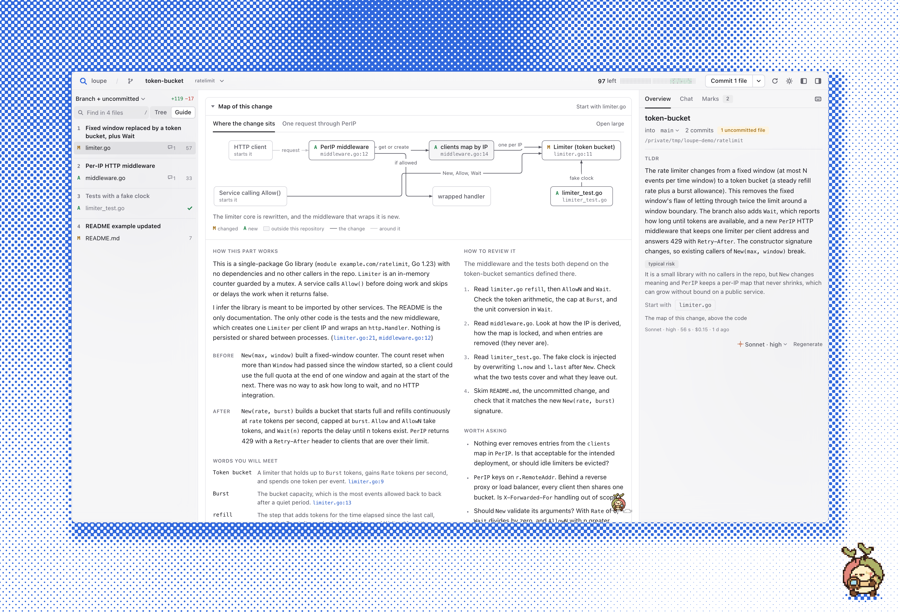

# loupe

A local review desk for pull requests, branches and uncommitted work, with Claude or Codex beside the diff.


- **Read the change.** A split or unified diff of a PR, a branch, or your uncommitted work, one file after another,
  with what is left to read in the top bar. Jump to a definition, a reference or a search hit, and `[` brings you back
  to where you were.
- **A map of the change.** Before the first file, the model reads the code around the change and explains how that part
  of the system works, what was there before and after, the words you will meet, and where to start reviewing. It draws
  the parts involved with the change marked on them, and the runtime path as numbered steps. A `file:line` it cites
  opens at the line it quoted, even when the number is a few lines off.
- **Ask about lines.** Select lines and press `a`. The answer sits at the lines and opens beside the code. The model
  can read the repository and run read-only git; it cannot change anything.
- **Claude or Codex.** One picker lists the newest model of each line from both, taken from your own accounts and kept
  current as new ones ship. A conversation stays with the kind of model it started on.
- **A guide.** The change as a few sections in reading order, each with what to check. The file list switches between
  tree and guide order. Regenerate the guide, and the map, with any model.
- **Review on GitHub.** Press `c` on lines to add a comment to your pending review, then Comment, Approve or Request
  changes. A review started on GitHub shows up here, and the other way round.
- **Ship your own work.** Commit the files you pick, push, and open the PR, with the message drafted in the
  repository's style.
- **From Claude Code.** The mod puts each repository a session edits on loupe's home; `/loupe` prints the links, each
  with a chat that knows what the session did. The skill lets Claude open things in loupe for you.
- **Keyboard first.** `⌘K`, or a click on the title, finds any file, open change, commit or action; `f` searches the
  whole repository at the reviewed revision; `?` lists the keys.

Mote, the small beetle floating in the corner (drag him anywhere), shows what the desk is doing: working while an
answer or the map is being written, and jumping when you have read the last file.


<p> </p>

## Setup

You need Node 22 or newer and git. For pull requests, [gh](https://cli.github.com) signed in (`gh auth login`). For
Claude, Claude Code signed in (`claude`, then `/login`). For Codex, the Codex CLI signed in (`codex login`). loupe asks
through those logins and shows the models each one offers. `gopls` on your PATH adds hover and go-to-definition for Go.

```bash
git clone https://github.com/lolwierd/loupe && cd loupe
./install.sh
```

`install.sh` installs the dependencies and the `loupe` command, starts the service that keeps loupe at
http://loupe.local and l.local from login (macOS), and adds loupe's Claude Code mod and skill. Then it runs
`loupe doctor`, which checks every piece: the gh, Claude Code and Codex sign-ins (and that loupe's own call to Claude
Code is signed in), both names, port 80 and the service. Run it again any time. `--no-service` and `--no-claude` skip those steps.

Then, in any repository:

```bash
loupe                                          # this branch and its uncommitted work
loupe https://github.com/owner/repo/pull/123   # a pull request
```

Without the service, `loupe serve` runs it in a terminal at http://127.0.0.1:4500.
Swap `github.com` for `loupe.local` (or `l.local`) in a pull request link to open it in loupe. https is optional:
[docs/HTTPS.md](docs/HTTPS.md).

## Keys

| Key | Does |
|---|---|
| `j` `k` | next and previous file |
| `]` | done with this file: mark it viewed and go to the next |
| `[` | back to where you were before a jump |
| `/` `f` | find a file, search the repository |
| `v` `o` | mark viewed, fold |
| `a` `c` | on selected lines: ask, comment for your review |
| `s` `g` | split or unified, guide order |
| `⌘K` `?` | do anything, all keys |

## How it works

One daemon serves every workspace and keeps its state in `~/.loupe`. A pull request is fetched into a clone you already
have (looked for under `~/Projects`, `~/code`, `~/src` and `~/dev`, or the folders in `LOUPE_SEARCH`) and read from its
own worktree, so your checkout is never touched. It answers only this machine. Every write to git or GitHub is
previewed first and checked again just before it runs, and nothing is written without your click.

The models come from Claude Code's own list (asked at start and every six hours) and from the Codex CLI's model cache
(read again when it changes). Codex runs in its read-only sandbox, with no approvals and no network.

`LOUPE_PORT` and `LOUPE_HOME` move the port and the state. `npm test` runs the tests. [docs/COMPONENTS.md](docs/COMPONENTS.md)
is the one way each control is drawn.
