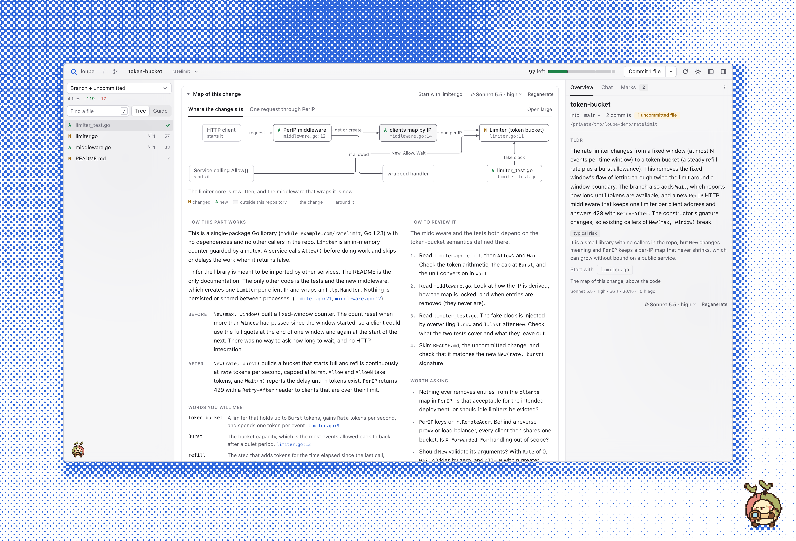

# loupe

A local review desk for pull requests, branches and uncommitted work, with Claude or Codex beside the diff.


- **Read the change.** A split or unified diff of a PR, a branch, or your uncommitted work, one file after another.
  The top bar shows what is left as a small board of lamps, one block per file as long as its changed lines: a file
  turns green as you mark it viewed, and pointing at a block names its file. Jump to a definition, a reference or a
  search hit, and `[` brings you back to where you were; after `]`, it un-views that file and returns to it. A mark,
  clicked anywhere, takes you to its lines and lights them.
- **A note above each file.** As a change opens, a small model (the newest Haiku, unless you pick another in `⌘K`)
  writes one or two lines above each file that needs them: what part of the repository it is, and why this change has
  to touch it, linked to the other files it changes. Lockfiles, generated code and files whose role is plain from their
  path get none.
- **A map of the change.** Before the first file, the model reads the code around the change and explains how that part
  of the system works, what was there before and after, the words you will meet, and where to start reviewing. It draws
  the parts involved with the change marked on them, and the runtime path as numbered steps. A `file:line` it cites
  opens at the line it quoted, even when the number is a few lines off.
- **Ask about lines.** Select lines and press `a`, type, and press `↵`. The answer sits at the lines and opens beside
  the code. The model can read the repository and run read-only git; it cannot change anything.
- **Chat, and change it.** Beside the diff of your own checkout, the chat is Claude Code or Codex at work there: ask
  about the change, or have it changed. It edits files and runs commands without asking, all in a sandbox with no
  network that writes nothing outside the checkout; commits and pushes stay yours. **Edit in chat** on a question or a
  GitHub thread hands it over, with its lines and its words. A pull request's chat only answers: that checkout is
  loupe's own copy.
- **Claude or Codex.** One picker lists the newest model of each line from both, taken from your own accounts and kept
  current as new ones ship. A conversation stays with the kind of model it started on.
- **A guide.** The change as a few sections in reading order, each with what to check. The file list switches between
  tree and guide order. Regenerate the guide, and the map, with any model.
- **Review on GitHub.** Press `c` on lines to add a comment to your pending review, then Comment, Approve or Request
  changes. A review started on GitHub shows up here, and the other way round. The Overview gives a pull request's state,
  review, checks and branches as one list of facts, and its description as an outline you open part by part.
- **Ship your own work.** Commit the files you pick, push, and open the PR, with the message drafted in the
  repository's style.
- **From Claude Code.** The mod puts each repository a session edits on loupe's home; `/loupe` prints the links, each
  with a chat that knows what the session did. The skill lets Claude open things in loupe for you.
- **Keyboard first.** `⌘K`, or a click on the title, finds any file, open change, commit or action; `f` searches the
  whole repository at the reviewed revision; `?` lists the keys.

Mote, the small beetle floating in the corner (drag him anywhere; double-click him and he lifts his shell and flies
off, until Show Mote in `⌘K` calls him back), shows what the desk is doing: working while an answer or the map is
being written, and jumping when you have read the last file. He looks with his eyes, at the pointer when it is near
and at what just happened: the answer that landed, the file you viewed, which earns a little hop and a check off his
head. Left alone he lives a little, every so often: looks around, blinks, peeks at the code, hums, catches a glint on
his lens, shuffles, waves, and after a few quiet minutes dozes off until you move.

Small things answer what you do. Every button gives a little when pressed, by the pointer or by its key. Approving
prints a stamp with the commit you approved and leaves its impression under the review, which slips out of register
when the author pushes past it. A commit's new id flips in from its parent's. Nothing is cut short: the press that
runs while a pull request opens finishes its pass, and the count of lines left finishes each roll. Desk sounds are there too, off until you
turn them on in `⌘K`: a tick per file viewed that climbs as the change is read, a stamp on approve, and a bell when an
answer lands while the tab is in the background.



<p> </p>

## Setup

You need Node 22 or newer and git. For pull requests, [gh](https://cli.github.com) signed in (`gh auth login`). For
Claude, Claude Code signed in (`claude`, then `/login`). For Codex, the Codex CLI signed in (`codex login`). loupe asks
through those logins and shows the models each one offers. `gopls` on your PATH adds hover and go-to-definition for Go.

```bash
git clone https://github.com/lolwierd/loupe && cd loupe
./install.sh
```

`install.sh` installs the dependencies and the `loupe` command, starts the service that keeps loupe at
http://loupe.local and l.local from login (macOS), and adds loupe's Claude Code mod and skill. Then it runs
`loupe doctor`, which checks every piece: the gh, Claude Code and Codex sign-ins (and that loupe's own call to Claude
Code is signed in), both names, port 80 and the service. It asks whether to set up https for loupe.local and l.local (with
[mkcert](https://github.com/FiloSottile/mkcert): your password once, for its local certificate authority; `--https` and
`--no-https` answer for it). Run it again any time. `--no-service` and `--no-claude` skip those steps.

Then, in any repository:

```bash
loupe                                          # this branch and its uncommitted work
loupe https://github.com/owner/repo/pull/123   # a pull request
```

Without the service, `loupe serve` runs it in a terminal at http://127.0.0.1:4500.
Swap `github.com` for `loupe.local` (or `l.local`) in a pull request link to open it in loupe. https is optional:
[docs/HTTPS.md](docs/HTTPS.md).

## From GitHub: the extension

`extension/` is a small Chromium extension, loaded unpacked (no build). On github.com, `g` then `l` opens the pull
request you are on in loupe, in place of GitHub's own `g` `l`; the toolbar button does the same, and a right-click on
any pull request link has **Open link in loupe**. Its settings can open pull requests in loupe as you land on them (off
by default). [extension/README.md](extension/README.md) has how to load it and what each setting does.

## Keys

| Key | Does |
|---|---|
| `j` `k` | next and previous file |
| `]` | done with this file: mark it viewed and go to the next |
| `[` | back: un-view the file `]` just marked, or return from a jump |
| `/` `f` | find a file, search the repository |
| `v` `o` | mark viewed, fold |
| `a` `c` | on selected lines: ask, comment for your review |
| `↵` `⇧↵` | send a question, new line (text for GitHub posts with `⌘↵`) |
| `s` `g` | split or unified, guide order |
| `⌘K` `?` | do anything, all keys |

## How it works

One daemon serves every workspace and keeps its state in `~/.loupe`. A pull request is fetched into a clone you already
have (looked for under `~/Projects`, `~/code`, `~/src` and `~/dev`, or the folders in `LOUPE_SEARCH`) and read from its
own worktree, so your checkout is never touched. It answers only this machine. Every write loupe makes to git or
GitHub is previewed first and checked again just before it runs, and nothing is written without your click. A chat in
your own checkout edits it when you ask, in the sandbox: no network, so nothing it does leaves the machine.

The models come from Claude Code's own list (asked at start and every six hours) and from the Codex CLI's model cache
(read again when it changes). Codex answers in its read-only sandbox (a chat in your checkout: workspace-write), with
no approvals and no network. File notes are one
small call per change, made again only for the files that changed since; the settings menu turns them off.

`LOUPE_PORT` and `LOUPE_HOME` move the port and the state. `npm test` runs the tests. [docs/COMPONENTS.md](docs/COMPONENTS.md)
is the one way each control is drawn.

## License

Released into the public domain under [the Unlicense](LICENSE).
