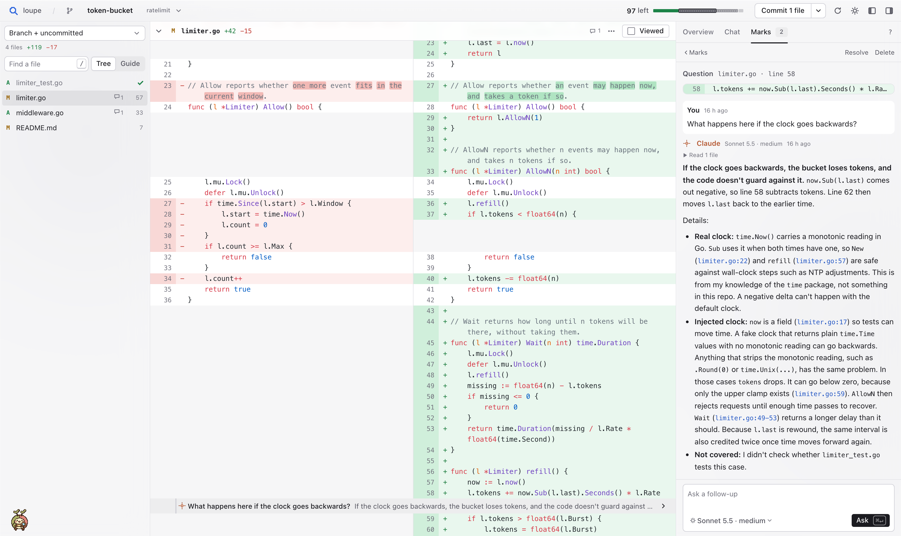
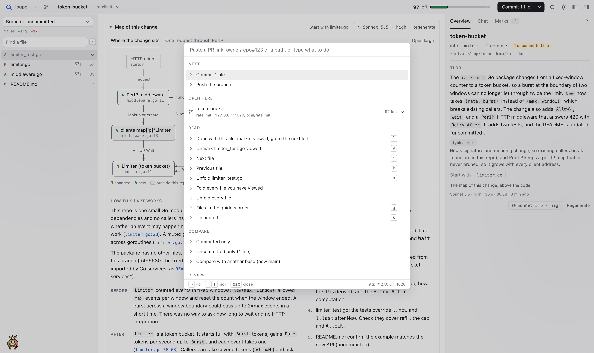

# loupe

A local review desk for pull requests, branches and uncommitted work, with Claude or Codex beside the diff.


- **Read the change.** A split or unified diff of a PR, a branch or your uncommitted work, with go-to-definition,
  references and search. A strip of lamps in the top bar shows what is left to read.
- **A map of the change.** Before the first file, the model reads the code around the change and explains how that
  part of the system works, what changes, and where to start. It draws the parts involved with the change marked on
  them, and the runtime path as numbered steps.
- **A guide.** The change as a few sections in reading order, each with what to check, and a short note above each
  file on why the change touches it.
- **Ask about lines.** Select lines, press `a` and ask. The answer sits at the lines. Questions are read-only.
- **Chat that can make the change.** In your own checkout the chat edits files and runs commands, in a sandbox with
  no network; commits and pushes stay yours. **Edit in chat** hands a question or a GitHub thread over to it.
- **Claude or Codex.** One picker with the newest models of each, through your own logins.
- **Stacks.** The PRs and branches a change sits on and the ones built on it, whether declared on GitHub or implied
  by the commits.
- **Review on GitHub.** Comment on lines, then Comment, Approve or Request changes. A review started on GitHub shows
  up here too.
- **Ship your own work.** Commit the files you pick, push, and open the PR, with the message drafted in the
  repository's style.
- **From Claude Code.** The plugin puts each repository a session edits on loupe's home, with a chat that knows what
  the session did; `/loupe` prints the links.
- **Keyboard first.** `⌘K` finds any file, change, commit or action; `?` lists the keys.

Mote, the small beetle in the corner, shows what the desk is doing: working while an answer is written, looking it over
when it lands, jumping when you finish the last file. Drag him anywhere; double-click him and he flies off.


<p> </p>

## Setup

You need Node 22 or newer and git. For pull requests, [gh](https://cli.github.com) signed in (`gh auth login`). For
Claude, Claude Code signed in (`claude`, then `/login`); for Codex, the Codex CLI (`codex login`). `gopls` on your
PATH adds hover and go-to-definition for Go.

```bash
git clone https://github.com/lolwierd/loupe && cd loupe
./install.sh
```

`install.sh` installs the `loupe` command, starts a service that keeps loupe at http://loupe.local and l.local
(macOS), adds the Claude Code plugin and skill, asks whether to set up https, and runs `loupe doctor` to check the
sign-ins. Run it again any time; `--no-service`, `--no-claude`, `--https` and `--no-https` skip or answer those steps.

Then, in any repository:

```bash
loupe                                          # this branch and its uncommitted work
loupe https://github.com/owner/repo/pull/123   # a pull request
```

Without the service, `loupe serve` runs it in a terminal at http://127.0.0.1:4500. To open a pull request from
GitHub, swap `github.com` for `loupe.local` in its link. https is optional: [docs/HTTPS.md](docs/HTTPS.md).

## The browser extension

`extension/` is a small Chromium extension, loaded unpacked. On github.com, `g` then `l` opens the pull request you
are on in loupe, and a right-click on any pull request link has **Open link in loupe**.
[extension/README.md](extension/README.md) has the rest.

## Keys

| Key | Does |
|---|---|
| `j` `k` | next and previous file |
| `]` | done with this file: mark it viewed and go to the next |
| `[` | back: un-view the file `]` just marked, or return from a jump (so do the mouse's back button and `⌘[`) |
| `/` `f` | find a file, search the repository |
| `v` `o` | mark viewed, fold |
| `a` `c` | on selected lines: ask, comment for your review |
| `↵` `⇧↵` | send, new line (text for GitHub posts with `⌘↵`) |
| `s` `g` | split or unified, guide order |
| `⌘K` `?` | do anything, all keys |

## How it works

One daemon serves every workspace, keeps its state in `~/.loupe`, and answers only this machine. A pull request is
fetched into a clone you already have (under `~/Projects`, `~/code`, `~/src` or `~/dev`, or the folders in
`LOUPE_SEARCH`) and read from loupe's own worktree, so your checkout is never touched. Anything loupe writes to git or
GitHub is previewed first and waits for your click.

`LOUPE_PORT` and `LOUPE_HOME` move the port and the state, and `npm test` runs the tests. If you change how something
looks, [docs/COMPONENTS.md](docs/COMPONENTS.md) is the one way each control is drawn.

## License

Released into the public domain under [the Unlicense](LICENSE).
